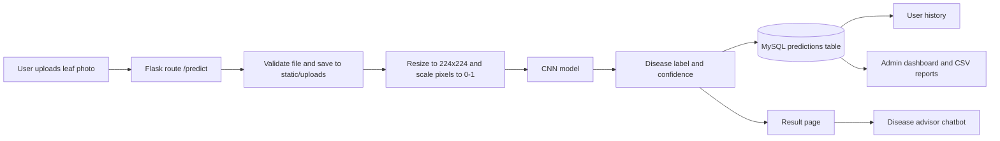
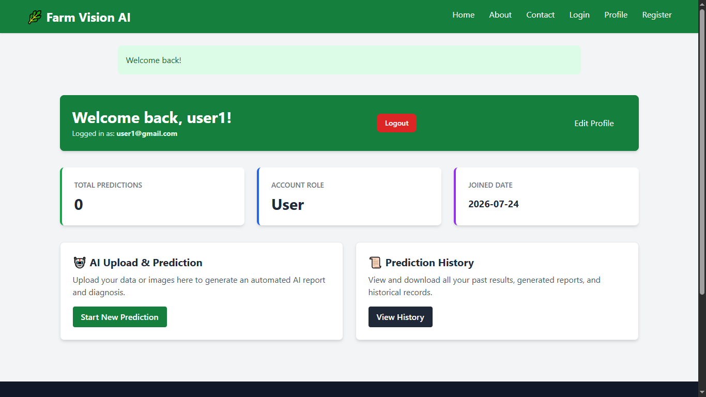

# 🌾 FarmVision AI

**AI-powered crop disease detection web app built with Flask and TensorFlow.**
Capstone Project from a Team Based Task.

A farmer or agronomist uploads a photo of a potato or tomato leaf. A convolutional neural network identifies the disease, the result is saved to the user's history, and a built-in advisor explains symptoms, treatment and prevention.


## Features

**Users**
- Register, log in, edit profile and change password
- Upload a leaf photo and get a disease label with a confidence score
- View past predictions in a personal history
- Ask the rule-based advisor about symptoms, treatment and prevention
- Send a message through the contact form

**Admins**
- See totals and recent activity on a dashboard
- Search and delete users, predictions and contact messages
- Export users, predictions and contacts as CSV

### Detected classes

| Crop | Classes |
| :--- | :--- |
| 🥔 Potato | Early Blight, Late Blight, Healthy |
| 🍅 Tomato | Target Spot, Yellow Leaf Curl Virus, Mosaic Virus |

## How it works



1. **Authenticate:** Flask-Login manages the session and passwords are stored as bcrypt hashes.
2. **Upload:** Flask-WTF validates the form, the CSRF token and the file type (JPG or PNG).
3. **Preprocess:** `utils/predictor.py` resizes the image to 224×224 and scales pixel values to 0–1.
4. **Predict:** the Keras CNN returns a probability for each of the 6 classes. The highest one becomes the label and confidence.
5. **Store:** the result is saved in MySQL against the logged-in user.
6. **Advise:** `services/disease_advisor.py` matches keywords in the question against a fixed guidance table. It does not use an LLM.

### Model

| Item | Value |
| :--- | :--- |
| Type | Sequential CNN built with Keras |
| Layers | 3 × (Conv2D + MaxPooling2D) → Flatten → Dense → Dropout → Dense (6 outputs) |
| Input | 224 × 224 RGB image |
| Parameters | About 11.2 million |
| File | `crop_disease_model.keras` (134 MB, stored with Git LFS) |

## Tech stack

| Layer | Technology | Why it is used |
| :--- | :--- | :--- |
| Backend | Python, Flask, Blueprints | Lightweight, and shares a language with the ML model. Blueprints separate auth and admin code |
| Machine learning | TensorFlow / Keras | Standard tooling for building and serving image classifiers |
| Image handling | Pillow, NumPy | Turn an uploaded photo into the array the model expects |
| Database | MySQL, PyMySQL | Users, predictions and messages are related data that suit a relational database |
| ORM and migrations | Flask-SQLAlchemy, Flask-Migrate | Models are written in Python and schema changes are versioned |
| Auth and security | Flask-Login, Flask-Bcrypt, Flask-WTF | Sessions, password hashing, form validation and CSRF protection |
| Frontend | Jinja2, Tailwind CSS (CDN) | Server-rendered pages with no separate frontend build |
| Configuration | python-dotenv | Keeps secrets out of the source code |
| Large files | Git LFS | The model is larger than GitHub's 100 MB file limit |

## Project structure

```text
├── app.py                  # App entry point, general and chatbot routes
├── config.py               # Settings loaded from .env
├── extensions.py           # db, bcrypt, login manager, migrate
├── auth/                   # Register, login, predict, history, profile, contact
├── admin/                  # Admin dashboard, management and CSV exports
├── models/                 # User, Prediction, ContactMessage
├── services/               # Disease advisor
├── utils/predictor.py      # Loads the model and runs predictions
├── migrations/             # Database schema versions
├── templates/              # Jinja2 pages
├── static/                 # Images and uploaded files
└── crop_disease_model.keras
```

## Getting started

**Requirements:** Python 3.11, MySQL 8 and [Git LFS](https://git-lfs.com).

```bash
# 1. Clone (Git LFS downloads the model)
git lfs install
git clone https://github.com/jaydip666/-FarmVision-AI.git
cd ./-FarmVision-AI

# 2. Create a virtual environment
python -m venv venv
venv\Scripts\activate        # Windows
source venv/bin/activate     # macOS / Linux

# 3. Install dependencies
pip install -r requirements.txt

# 4. Configure the app: copy the example, then fill in your values
cp .env.example .env         # Windows CMD: copy .env.example .env
```

Create the database in MySQL:

```sql
CREATE DATABASE farmvision;
```

Create the tables and start the app:

```bash
flask --app app db upgrade
python app.py
```

Open http://127.0.0.1:5000.

### Create an admin

Register a normal account, then promote it in MySQL:

```sql
UPDATE users SET role = 'admin' WHERE email = 'your@email.com';
```

## Screenshots

| User dashboard | AI prediction | Admin panel |
| :---: | :---: | :---: |
|  |  |  |

## Known limitations

- **Model accuracy is unverified.** The original `train` and `test` folders contained the same 6,108 images, so no independent accuracy was measured. The 96.4% figure on the home page has not been confirmed.
- **The dataset is imbalanced.** Class sizes range from 152 images (Potato Healthy) to 2,179 (Tomato Yellow Leaf Curl Virus).
- **The dataset and training code are not in this repository.** Only the trained model is included.
- **The app recognises 6 classes only.** A photo of any other plant still gets one of these labels.
- **There is no email-based password recovery.** Logged-in users can change their password. A forgotten password must be reset by an administrator in the database.
- **Uploads with the same filename overwrite each other.**
- **The app runs in Flask debug mode.** It is meant for local demonstration, not production.

> A photo-based prediction is not a definitive diagnosis. Confirm serious or spreading damage with a local agricultural extension service.
